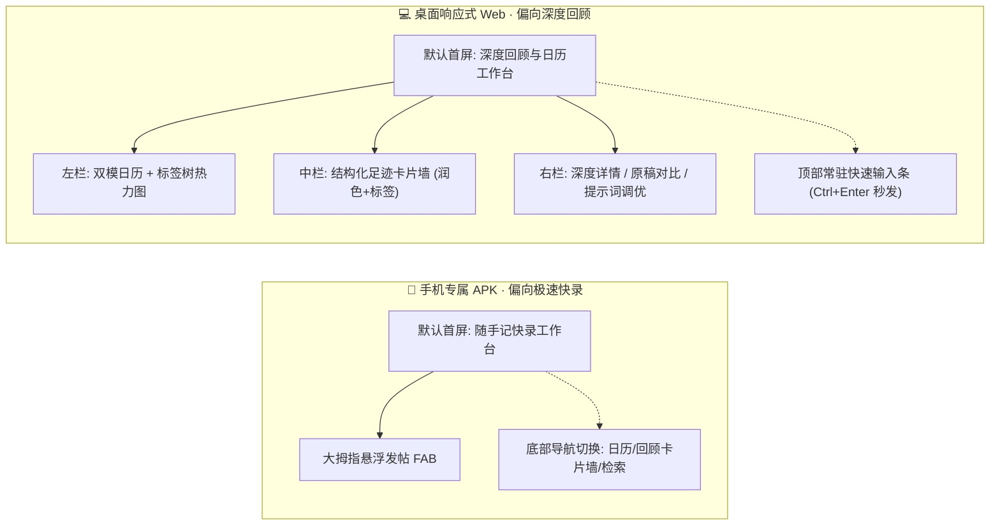

# ChronoLog (时光足迹) · 智能知识库与双模日历系统设计蓝图 (v2.6)

> 2026-11-07 实施状态：Go／Vue 工程及基础流程已实现，Android 工程仍待交付。实际闭环与剩余项见 [开发实施状态](docs/开发实施状态.md)，运行命令见 [Windows 指南](Windows本机开发指南.md)。本文完整产品设计不代表所有功能已完成。正式更新使用 GitHub 与 Git 获取本机构建产物，见 [部署与运维](docs/部署与运维.md)。

> 更新日期：2026-11-07。本文描述完整产品目标；已有 Go／Vue 实现，未交付项见开发实施状态。N100 当前沿用正式 systemd 服务，通过 Git 获取开发侧预构建产物。

> **设计核心准则**：
> 1. **双端无缝且各有侧重（功能全具备，体验各专精）**：
>    - **手机端（偏向极速快录）**：首屏优先呈现大面积舒适输入区与大拇指悬浮发帖 FAB，同时具备底部导航无缝切换至日历、回顾流与检索。
>    - **Web端（偏向内容回顾与复盘）**：首屏优先呈现三栏式知识工作台与双模日历看板，多维度回顾沉淀卡片，同时支持顶部常驻输入框与 `Ctrl/Cmd + Enter` 秒发。
> 2. **结构化卡片呈现（润色记录 + 交互标签，非生硬 MD 文档）**：查阅回顾时，系统以精心排版的**高颜值卡片流**呈现，包含清晰排版的润色正文、可点击一键过滤的标签胶囊、醒目的提醒状态徽标，以及可一键折叠/展开的原稿对照。
> 3. **轻量部署（应用单一容器与二进制）**：Web 资源通过 Go 原生 `embed.FS` 嵌入单一二进制，不为 ChronoLog 增加独立前端服务或数据库容器。原先提出的空闲常驻 **10MB～15MB** 是待验证目标，不能视为保证值；需记录数据量、并发与 AI 处理中等测量条件。
> 4. **显式提示词工程（透明、可调、专业）**：默认模板（`config/prompts.example.yaml`）复制为独立可写的本地配置，结合 Web 设置页调优，使用动态基准时钟、Few-Shot 和结构化输出校验。
> 5. **开放平铺笔记存储**：笔记采用 **Markdown (`.md`) + YAML FrontMatter** 存储于各用户的平铺 `notes/` 目录，SQLite 仅作为可重建的笔记索引。账号哈希、用户设置和通知配置另行持久化，完整备份不能只复制笔记。

## 开发与运行边界

- Windows 原生运行 Go／Vite 进行日常浏览器调试，不要求 Docker、WSL2 或 Make；Android 工具链补齐后再打包 APK。
- N100 仅正式运行，正式镜像在开发侧构建，功能验收在本机完成；不在 N100 构建、调试或部署临时验收容器。每次连接（包括只读检查、HTTP／AI 调用与探测）必须先取得用户对本次目的和范围的明确同意，历史授权不自动延续。
- 当前个人使用仍保留注册、登录和多账号隔离；无需复杂 CI/CD 或长期测试环境。开发使用本机模拟 AI 与模拟通知，不自动连接或回退到 N100 服务；本机测试数据与正式数据独立。
- Android 优先复用本机 Node.js、VS Code 与 Gradle 缓存，补齐独立 JDK 21 和 SDK，使用 USB 真机连接本机服务；Android Studio 可选。具体见 [Android 本机开发计划](Android本机开发计划.md)。
- 2026-11-06 调整 Android 交付优先级：先提供可安装且具备基础记事流程的 Debug APK，手机端仅做安装、启动与核心流程检查，其他适配、优化和扩展依据用户后续反馈推进；完整产品规划不作为首包全部实现的前提。
- 本文及实战手册中的时间戳统一为带偏移量的 RFC 3339，默认时区 `Asia/Shanghai`。字段和状态以实战手册为准。

---

## 一、 双端差异化交互与全功能矩阵

虽然两端均具备「录入、日历、检索、查看、设置」的完整全功能，但在信息层级与交互动线上进行了精细化的场景侧重：



### 1. 手机端 (Android APK)：随行手账，秒开秒记
- **首屏主视觉**：极简高效的纯文本快录板，键盘自动避让，大拇指热区常驻高对比度发帖 FAB。
- **回顾体验**：滑动或底部 Tab 一键切至「足迹回顾」，卡片适配手机单手上下刷阅，标签支持横向轻滑筛选。
- **全功能闭环**：包含双模日历弹层、全文关键词检索与通知渠道设置。

### 2. Web 桌面端：沉浸式复盘与知识回顾工作台
- **首屏主视觉**：大屏三栏全景工作台，一眼尽览时光脉络：
  - **左栏（导航与时间）**：月历视图（高亮历史打卡天数，标注未来待办），直观呈现过去一周/一月的记录频次与标签层级树；
  - **中栏（内容回顾流）**：精美的图文卡片流，直观展示 AI 润色后的工作与生活条目，点击卡片上的标签胶囊即可秒级筛选；
  - **右栏（详情与拓展）**：展开完整上下文，提供原稿与 AI 润色版左右对照滑动器，以及系统级提示词调优看板。
- **极速记录通道**：工作台中随时提供顶部吸顶录入区，配合快捷键 `Ctrl/Cmd + Enter`，在电脑前办公时随想随记同样无需多余跳页。

---

## 二、 回顾内容卡片化呈现规范（拒绝生硬 MD 文件）

在用户进行内容回顾时，摒弃传统的“像是在读一个冰冷 Markdown 文本文件”的感觉，采用现代优雅的**卡片化视觉容器（Card UI）**：

```text
┌────────────────────────────────────────────────────────────────────────┐
│ 🕒 2026-10-28 14:30 (今天下午)              ⏰ 提醒: 明天 15:00 · 待办  │
├────────────────────────────────────────────────────────────────────────┤
│                                                                        │
│  ✨ 今日工作进展 (AI 润色)                                              │
│  • 方案定稿：全面修改并确定李总项目方案，完成 3 轮 PPT 结构优化。       │
│  • 商务沟通：下午与老王就合同细节展开讨论并达成一致。                  │
│                                                                        │
│  📌 后续待办                                                           │
│  • 明天下午 15:00 需将终稿提交法务团队审核。                           │
│                                                                        │
├────────────────────────────────────────────────────────────────────────┤
│  🏷️ #工作/项目方案   🏷️ #商务/合同           [👁️ 查看随手记原稿 ▾]       │
└────────────────────────────────────────────────────────────────────────┘
     │ (点击任意标签即刻按该分类过滤)             │ (展开查看未润色的真实草稿)
```

### 卡片组件的核心视觉与交互规范：
1. **顶部元数据条**：呈现相对时间（如“3小时前 / 昨天 09:20”），若大模型识别出待办提醒，展示彩色状态胶囊徽标（如 `⏰ 明天 15:00 待处理`）。
2. **正文润色区**：采用高品质排版（支持加粗关键词、清晰的列表项目符号、任务复选框），排版规整，阅读体验极其清爽。
3. **底部交互标签胶囊**：所有标签以圆角胶囊块（Pill Chips）呈现，**点击任意标签直接在当前视图中秒级筛选出同类卡片**。
4. **原稿抽屉开关（折叠设计）**：默认保持润色后正文的整洁度；右下角提供轻量展开按钮，点击即可平滑展开灰色引用块展示当时敲下的原始随笔草稿，保证“真实原声”永不丢失。
5. **快捷操作**：悬浮提供复制正文、快捷编辑、删除及标记待办完成。

---

## 三、 显式大模型提示词工程 (Prompt Engineering)

提示词系统采用**外置显式配置化架构**，绝不黑盒硬编码。

### 1. 显式配置文件（默认 `config/prompts.example.yaml`）
```yaml
version: "1.0"
model_settings:
  temperature: 0.2          # 低温保证结构化输出与逻辑确定性
  max_tokens: 1500

system_prompt: |
  你是一位专业的个人知识管理架构师兼高敏执行秘书。
  你的任务是处理用户输入的原始笔记，完成三项核心工作：
  1. 【内容润色与重构】：修正口语、错别字，梳理为优美、清晰、专业的 Markdown 笔记。
  2. 【多维标签分类】：提取 1-3 个精炼的多层级标签（优先参考用户现有标签库）。
  3. 【日程与备忘抽取】：严格依据当前参考时间，识别输入中明确包含的未来待办或提醒诉求。

dynamic_context_template: |
  【系统参考时间】：{{CURRENT_DATETIME}} ({{CURRENT_WEEKDAY}})
  【用户现有标签库】：{{USER_TAGS}}
  【用户原始笔记内容】：
  """
  {{RAW_CONTENT}}
  """

few_shot_examples:
  - reference_time: "2026-10-28T14:30:00+08:00"
    input: "今天把李总的项目方案写完了，改了三遍PPT，下午和老王讨论了合同，明天下午三点得把终稿发给法务"
    output:
      polished_content: "### 今日工作进展\n- **方案定稿**：全面修改并确定李总项目方案，完成 3 轮 PPT 结构优化。\n- **商务沟通**：下午与老王就合同细节展开讨论并达成一致。\n\n### 后续待办\n- 明天下午 15:00 需将终稿提交法务团队审核。"
      tags: ["工作/项目方案", "商务/合同"]
      reminders:
        - title: "将项目方案终稿发送法务审核"
          remind_at: "2026-10-29T15:00:00+08:00"
          reason: "用户明确提及明天下午三点发送终稿"

  - reference_time: "2026-10-28T14:30:00+08:00"
    input: "刚去试驾了新车，感觉底盘调校偏硬，加速响应很灵敏，整体不错"
    output:
      polished_content: "试驾体验记录：车辆底盘调校偏运动偏硬，动力加速响应敏捷，整体综合驾驶质感良好。"
      tags: ["生活/随笔", "体验/汽车"]
      reminders: []

constraints: |
  【输出格式与严格约束】：
  1. 必须仅返回合法的纯 JSON 字符串，不得包含任何 Markdown 代码块标签（如 ```json 前缀）。
  2. JSON 必须严格包含三个字段：polished_content (string), tags (string[]), reminders (array of objects)。
  3. 若无明确未来待办，reminders 必须返回空数组 []。已发生的历史事实绝对不得提取为提醒。
  4. remind_at 必须是带偏移量的 RFC 3339 时间戳；示例日期只相对于各自 reference_time，处理真实笔记时使用该笔记的基准时间。
```

---

## 四、 纯文本平铺存储规范（100% 易迁移）

```text
data/
├── accounts.db                    # 账号哈希及用户设置，持久数据，不能由笔记重建
└── users/
    └── user@example.com/           # 服务端由认证身份映射并校验后的目录
        └── notes/                  # 单一平铺目录，存放全部 Markdown 文本
            ├── 20261028_143022_a8f9.md
            └── 20261029_091000_f7e2.md
```

标准 Markdown 文件（YAML FrontMatter）：
```markdown
---
id: "20261028_143022_a8f9"
created_at: "2026-10-28T14:30:22+08:00"
updated_at: "2026-10-28T14:30:25+08:00"
raw_content: "今天把李总的项目方案写完了，改了三遍PPT，下午和老王讨论了合同，明天下午三点得把终稿发给法务"
processing_status: "ready"
tags:
  - 工作/项目方案
  - 商务/合同
reminders:
  - id: "rem_01"
    title: "将项目方案终稿发送法务审核"
    remind_at: "2026-10-29T15:00:00+08:00"
    status: "pending"
    notification_status: "pending"
---

### 今日工作进展
- **方案定稿**：全面修改并确定李总项目方案，完成 3 轮 PPT 结构优化。
- **商务沟通**：下午与老王就合同细节展开讨论并达成一致。

### 后续待办
- 明天下午 15:00 需将终稿提交法务团队审核。

```

`raw_content` 由 YAML 序列化器无损读写；原稿抽屉从该字段生成，不能通过正文引用块分隔原稿。Markdown 正文存润色结果；处理失败时仍保留原稿。`processing_status` 取 `processing`、`ready`、`failed`。

提醒的 `status` 为 `pending | completed | cancelled`，只表示用户待办状态；`notification_status` 为 `pending | sent | failed`。推送成功只置 `sent`，不自动完成待办；重试需持久化去重与失败信息，服务重启不能恢复成每分钟重复发送。

---

## 五、 服务端部署与资源验证

- **单一容器与二进制自嵌**：前端静态代码通过 Go 语言标准的 `embed.FS` 机制直接编译进单一 Go 二进制程序中。
- **开箱即用**：
  - 启动后仅此一个进程，自动同时提供 RESTful 后端 API 和 Web 端前端界面；
  - 杜绝额外启动 Nginx 容器或 Node.js 服务；
  - 镜像大小、构建耗时与功能负载测试在开发侧记录；正式运行的内存与 CPU 仅在用户同意的运维连接中观测，不在 N100 做开发压测。
  - 在用户同意的正式运维范围内备份运行数据、账号与配置，恢复演练在本机隔离环境完成；正式数据传输也必须包含在同意范围内。
